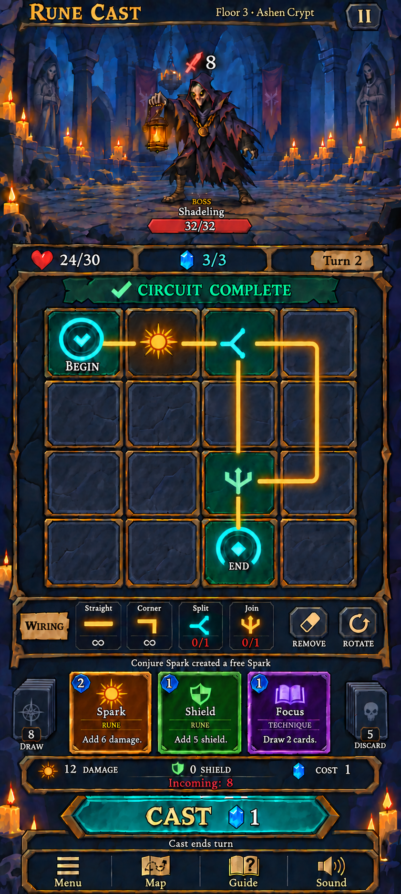

# Official final gameplay visual — October 11, 2026

**October 13 evaluator/control clarification:** The owner approved the RC-016A contract and requested **Pass turn** in the WIRING-label position beside the four connector tools. Production now uses undirected logical ports, the accepted branch/rejoin and feedback rules, Remove/Rotate controls, safe inspection access, detailed cards, live piles and the forecast above Cast. The retained approved image is unchanged; the Pass turn placement is a subsequent owner instruction. See [decisions](decisions.md#october-13-2026--rc-016a-undirected-graph-and-controls-accepted), [gameplay rules](gameplay-rules.md) and [touch interactions](touch-interactions.md). Full painted Combat integration remains RC-016; migration evidence and completion status are recorded separately in [verification](verification.md).

**October 12 Menu/progression clarification:** The menu's former Shop label is now **Store**, a separate destination for purchasing in-game items such as runes, perks and relics. It is not a shortcut restricted to shop rooms. Entering a shop room opens that room as the main screen. The owner also intends permanent rune acquisition from conquering a map or defeating a hard boss; detailed progression and purchase rules remain planned. This updates Menu semantics without altering the retained approved images or the Combat requirements below. See the current [design specification](v1-design-spec.md) and [current corrected menu specimen](../output/art/rc-013/menu-button-revert/menu-open-360x640.png).

The owner most recently requested: “Please use this one as approved final version of gameplay,” supplying the clean-board image below. This is the **current approved final Combat visual target**, superseding the earlier labelled/numbered board and prior Split/Join symbols. The complete crypt/supporting-UI scope remains. Home, Map and Menu retain their existing approvals.

The [canonical image](../output/imagegen/approved/combat-final-v2-clean-board.png) is an exact841×1870 copy of the latest supplied PNG, with no regeneration, retouching or resizing. [Current approval evidence](../source-assets/pilot/revisions/r005/delivery.md) records the exact attachment and comparison with v10. [Previous approved image](../output/imagegen/approved/combat-final.png) and r003/r004 sources/reviews remain preserved. This is a finished visual reference, not a layered production asset or runtime screenshot.

## Approved visual and interaction changes

| Requirement | Final image and implementation target |
| --- | --- |
| Complete painted screen | Full indigo crypt, stone floor/statues/candles, centered Shadeling and lantern, complete gold/navy/turquoise frames, serif labels and supporting UI. No placeholder environment, question-mark symbol or flat substitute panel may stand in for these in a future matching preview |
| Undirected circuits | Circuit connection strokes have no flow arrowheads. Wiring glyphs use the corrected approved silhouettes below. Compatible connected ports have no input/output direction requirement. Rotate changes connection geometry; its curved arrow represents an editing action |
| Clean board | Only **BEGIN** and **END** retain text inside the4×4board. Remove SPARK/SPLIT/JOIN and other slot names, rune values, branch totals, End total, cost badges and TEMP. Keep glyphs and connections. This does not remove labels/values from hand cards, toolbar, piles or external summary |
| Corrected Split/Join | Use the supplied **sideways fork** for Split (left stem, upper-right/lower-right branches) and **upright trident** for Join, on both board and wiring toolbar. Replace the r004 Y/T substitutes. Match the illustrated silhouettes; decorative terminal points do not restore directional port rules or by themselves redefine port counts |
| Editing actions | **Remove** and **Rotate** only. Remove Flip, Undo, Inspect, Cancel selection and Details / Pass from this gameplay control area. The eraser icon labels Remove. Wiring selection tools Straight, Corner, Split and Join remain |
| Pass turn | The October 13 owner clarification replaces the WIRING label with a visible **Pass turn** action beside the connector tools. It opens a confirmation showing incoming attack and cleanup, including from an incomplete circuit or empty hand; it is a turn action, not a third editing action |
| Hand and piles | Illustrated cards show energy cost, name, symbol, type and short effect description. Draw pile on the left and Discard pile on the right, each with a visible count |
| Information above Cast | Persistent bar shows damage, shield, energy cost and incoming damage directly above Cast. Keep the small action-log line above the hand |
| Primary action and navigation | Large turquoise pointed Cast, blue energy crystal and live cost; “Cast ends turn” beneath. Preserve Menu, Map, Guide and Sound navigation and the top pause control |

## Rules change and implementation boundary

The owner's directionless-circuit request changes gameplay as well as rendering. Connected compatible ports work in either traversal direction; a route is not rejected solely because an old input/output label is reversed. Begin remains the source and End the sink. Rotation-zero logical ports are Begin E, End N, Straight/rune W/E, Corner W/S, Split W/E/S and Join N/E/S. Split branches one route into two; Join merges two into one, with roles inferred from complete Begin-to-End routes. Decorative symbol tips do not define ports.

The October 13 decision permits ordinary branch/rejoin loops, rejects open powered ports, dead branches and conflicting feedback/cross-links, and prevents repeated execution of a physical rune. Split preserves amplification: Spark6 before two branches contributes12; a shared Spark6 after Join contributes6 once. Each physical rune or connector pays its casting cost once. End emits one aggregate damage event. The production evaluator now implements that contract; historical no-options/experiment evaluation remains directed.

Production now provides separate focusable Info buttons on hand cards, 450 ms hold-to-inspect, I/right-click inspection for pieces/tools, and circuit details through the persistent forecast. Escape or tapping the selected card/tool clears selection. Pass turn opens the accepted confirmation in the wiring row. Detailed cards reuse RC-013 components and RC-012 icons; pile counts, action log and forecast read live snapshots. The forecast stays visible as a page component above Cast and scrolls with that page. These bindings do not establish a complete rebuilt painted screen or device acceptance.

Dated documentation of the earlier directed controls remains historical evidence. Direction arrows, Flip/Undo/Inspect/Cancel/Details-Pass buttons, compact-only hand and no-forecast requirements must not be reintroduced into production. Existing affordability, busy-state, modal and terminal-state guards remain in force.

The latest image retains the yellow BOSS label above Shadeling's name/health. October 12 owner direction establishes Shadeling as a boss for one map encounter, with BOSS supplied by live role UI. Infinity stock, the particular board layout, HP, Turn2, Draw8/Discard5 and external12damage/1cost are illustrative values. The user did not separately request infinite connector supply, a guaranteed opening arrangement, or new balance values. The boss role does not establish final-guardian status, extra phases or permanent rewards. Removing board values does not remove their underlying gameplay data or the external forecast. Keep live state separate; do not bake this screen into the game as a replacement for controls.

## Scope and acceptance

The official final-image request is fulfilled by the exact supplied complete artwork. The earlier pilot's crypt/supporting-UI exclusions and permission to use placeholders are superseded for subsequent complete-preview production. Any rebuilt preview must match this entire image's visual construction; producing only a closer character/button does not meet that requirement.

This approval applies to this supplied image. It does not retroactively approve reconstructed assets, complete RC-012–RC-017, verify runtime behavior or prove device readiness. The [r006 editable pilot](../source-assets/pilot/revisions/r006/delivery.md) applies the latest board cleanup and corrected symbols while reusing r004 painted sources. Earlier revisions remain historical. Its assistant visual/source review is separate from owner approval of the supplied image. The original no-Git restriction remains in force.
