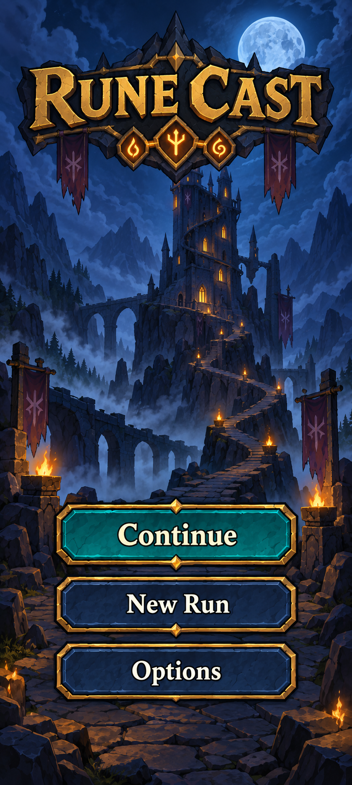
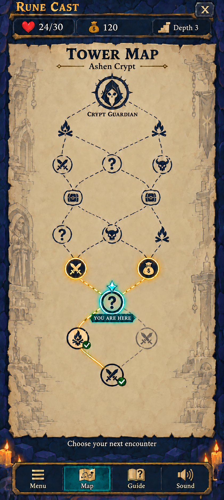
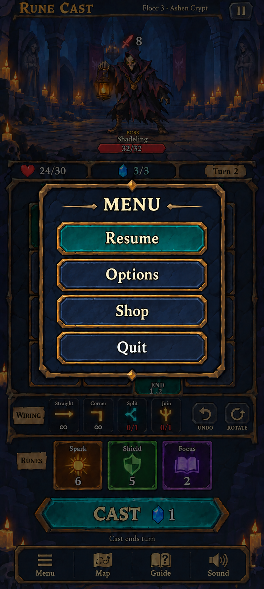

# Rune Cast visual reference

**Current owner-approved final:** [combat-final-v2-clean-board.png](../output/imagegen/approved/combat-final-v2-clean-board.png), preserved from the latest attachment exactly. [Approval record](../source-assets/pilot/revisions/r005/delivery.md). Its pixels match v10; this explicit approval supersedes the earlier final image and the r004 reconstruction's board treatment. Only Begin/End labels remain inside the board; all board values/cost badges/TEMP are absent; Split and Join use the corrected fork/trident silhouettes.

Latest revision: [Combat v10 — clean board](../output/imagegen/rune-cast-gameplay-reference-v10-clean-board.png). Only Begin and End retain labels inside the board. Other slot names, rune values, cost badges and the TEMP tag are removed; rune symbols and connections remain. Cards, toolbar labels and the external combat summary retain their information. This supersedes the earlier board text treatment below and is a visual reference change only.

The latest symbol correction is [Combat v9](../output/imagegen/rune-cast-gameplay-reference-v9-restored-symbols.png): Split uses its sideways fork and Join its upright trident on both the board and toolbar. Circuit lines remain undirected, Remove remains, and the branch/End numbers removed in v8 remain absent.

## Latest requested visual edit

[Combat v8: no path values](../output/imagegen/rune-cast-gameplay-reference-v8-no-path-values.png) applies the user's latest request to remove the two branch values (6 and 6) and End's value (12). Spark's own value and the damage summary remain visible. The earlier approved files below are preserved.

## Official final gameplay visual — October 11, 2026

The owner approved the latest attached image as the **official final gameplay visual**. Its exact file bytes are preserved as [combat-final-v2-clean-board.png](../output/imagegen/approved/combat-final-v2-clean-board.png), at841×1870pixels. The prior [combat-final.png](../output/imagegen/approved/combat-final.png) remains unchanged historical evidence. The complete painted crypt and supporting UI remain required, without placeholders.

The approved attachment keeps undirected circuits, Remove/Rotate, piles, detailed cards, action log and external forecast. It adds the clean board and corrected Split/Join symbols. No image edit was needed to preserve it. Decoded pixels match [Combat v10](../output/imagegen/rune-cast-gameplay-reference-v10-clean-board.png), although the PNG bytes differ. The [gameplay visual contract](gameplay-visual-contract.md) is authoritative.

Circuit validity must depend on connection geometry without directional requirements. Begin and End remain, and Rotate changes connection geometry. Flip, Undo, Inspect, Cancel selection and Details / Pass are removed from the requested editor UI. This owner-approved design change is not implemented by saving the image: the runtime still uses its older directed evaluator and controls. Split/Join resolution and repeat-trigger prevention for undirected networks need an explicit implementation update.

The October 8 [combat.png](../output/imagegen/approved/combat.png) remains preserved as a historical Combat reference. Home, Map and Menu retain their October 8 approvals unchanged. Current approved references take precedence over earlier mockups for screen composition, colours and styling.

| Screen | Approved reference | Visual requirements |
| --- | --- | --- |
| Home | [home.png](../output/imagegen/approved/home.png) | Moonlit tower, large Rune Cast logo, Continue, New Run, Options; turquoise Continue |
| Combat | [combat-final-v2-clean-board.png](../output/imagegen/approved/combat-final-v2-clean-board.png) | Complete painted crypt; undirected4×4board with Begin/End text only and no board numbers/badges; corrected Split fork/Join trident; Remove/Rotate, detailed hand/piles, action log, info bar, Cast and navigation |
| Map | [map.png](../output/imagegen/approved/map.png) | Parchment branching route, turquoise current node, gold next choices, completed checks; no encounter legend strip |
| Menu | [menu.png](../output/imagegen/approved/menu.png) | Centered overlay over dimmed gameplay; Resume, Options, Shop, Quit; turquoise Resume; matching navy Options, Shop and Quit |

Approval establishes the visual target and the explicitly requested undirected-circuit/editor design changes. These flattened references do not implement screen behaviour, finalise balance values or replace separated production assets. The Godot foundation still uses placeholders and the older controls. RC-002's [screen behavior contract](v1-design-spec.md#approved-screen-composition-and-proposed-behavior) remains useful historical context, but its Combat inspection and Pass proposals do not override the October 11 request. Home, Map and Menu behavior is unaffected.

## Other approved screens

## Layout to preserve

1. Slim title and floor header.
2. Enemy-only side-view arena; intent above the centered enemy, yellow BOSS label, name and health below. BOSS is illustrative reference text; Shadeling's roster role remains unchanged.
3. Player health, energy, and turn.
4. Circuit status and a square4×4board; only Begin/End text, no board values, cost badges or TEMP. Symbols and connections remain.
5. Reusable wiring tools with plain, undirected symbols; Remove and Rotate are the only editing actions.
6. An action log above detailed hand cards, with energy cost, name, symbol, type and description; draw and discard piles flank the hand.
7. A damage, shield, cost and incoming-damage info bar immediately above Cast.
8. A pointed turquoise Cast button, its energy cost and the turn-ending caption.
9. Menu, Map, Guide and Sound navigation.

The crypt, enemy, frames, panels, symbols, cards and navigation all belong to the approved full-screen composition. Blank arena blocks, generic supporting icons and other placeholders are not acceptable in the new matching preview.

## Reference circuit

| Row | Column 1 | Column 2 | Column 3 | Column 4 |
| --- | --- | --- | --- | --- |
| 1 | Begin | Temporary Spark | Split | Corner |
| 2 | Empty | Empty | Vertical wire | Vertical wire |
| 3 | Empty | Empty | Join | Corner |
| 4 | Empty | Empty | End | Empty |

Names in the table identify components for documentation; only Begin/End names are displayed on the actual board. No board damage totals, cost badges or TEMP appear in the new reference. Card details and the external12damage/1cost summary remain. Infinity stock and fixed Begin/End positions do not approve new stock or board-generation rules. The corrected glyph silhouettes do not reverse the accepted undirected-connection rule.

## History

| Version | Change |
| --- | --- |
| v1 | New Begin-to-End circuit and separate wiring/hand areas |
| v2 | Cartoon art direction |
| v3 | Expanded full-body boss arena and compact rune tiles |
| v4 | Centered boss and removed forecast bar |
| v5 | Added bottom navigation |
| v6 | [Undirected circuits](../output/imagegen/rune-cast-gameplay-reference-v6-undirected.png), detailed hand cards, draw/discard piles, action log and info bar above Cast; superseded compact rune-only/no-summary Combat layout |
| v7 | [Replaced Undo with Remove](../output/imagegen/rune-cast-gameplay-reference-v7-remove.png), retaining v6 layout and undirected circuit symbols |
| October 11 first final | Earlier owner-supplied attachment preserved exactly as [combat-final.png](../output/imagegen/approved/combat-final.png); superseded board treatment |
| v8 | Branch and End values removed; original [study](../output/imagegen/rune-cast-gameplay-reference-v8-no-path-values.png) preserved |
| v9 | Split/Join silhouettes corrected; original [study](../output/imagegen/rune-cast-gameplay-reference-v9-restored-symbols.png) preserved |
| v10 / approved final v2 | Clean board: only Begin/End labels, no board values/cost badges/TEMP. Latest exact supplied attachment approved as [combat-final-v2-clean-board.png](../output/imagegen/approved/combat-final-v2-clean-board.png) |

All images and their generation prompts are preserved in output/imagegen. These are design references, not layered or production-ready game assets.

## Playable foundation

The actual runtime screenshot is saved by the capture command to [foundation-screen.png](../output/qa/foundation-screen.png). It demonstrates functional controls and placeholder visuals; it is not a replacement for the approved art direction.

