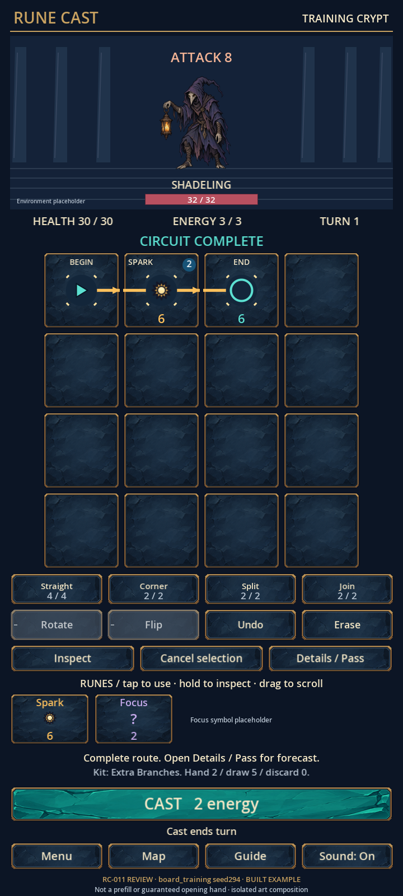

# RC-011 delivery index and r001 history

**Current production revision:** [r006 final-v2 gameplay pilot and review](revisions/r006/delivery.md), [main preview](../../output/art/rc-011/r006/pilot-720x1600.png), [editable composition](revisions/r006/pilot_review.svg). This applies the latest clean-board and corrected Split/Join changes to the expanded crypt/supporting-UI pilot. [r004 production history](revisions/r004/delivery.md) and all older revisions remain preserved. The r001 review and files below remain rejected historical evidence; consult r006 for current status.

**Superseded by the October11 final visual decision:** The owner selected the complete [official gameplay image](../../output/imagegen/approved/combat-final.png) and expanded the preview scope to include crypt/supporting UI with no placeholders. [r003 delivery](revisions/r003/delivery.md) records exact adoption of that supplied image and the new undirected/control/layout contract. The r001 review below remains historical and rejected; final-reference approval does not approve these separate assets.

Produced October10–11,2026; review corrected October11. **The owner rejected r001 because it does not match the approved gameplay reference. RC-011 requires visual revision. The earlier matching-style pass is withdrawn; this set must not become the RC-012 production baseline.** Existing files and structural checks remain evidence of artifact construction only. Nothing here is integrated production artwork or a physical-device result. The approved references already define the target; no new style choice is requested from the owner.

## Concrete review set

**Historical r002 correction:** [r002 sources, preview and findings](revisions/r002/delivery.md) retained the approved reference as the target and corrected character identity/scale, Spark, bevels, Cast and actual serif type. The original r001 set below remains rejected history; r002 did not establish full-screen fidelity or close RC-011.

| Asset ID | Editable source | Review-only exports and evidence |
| --- | --- | --- |
| `pilot_shadeling` | [shadeling/shadeling.ora](shadeling/shadeling.ora), [editable masks](shadeling/separation-masks.svg), [assembly/transform source](shadeling/assemble_shadeling.py) | [512px neutral](exports/shadeling.png), [seven full-canvas parts](exports/shadeling_parts/), [layer sheet](../../output/art/rc-011/pilot-shadeling-layers.png), [local delivery](shadeling/delivery.md), [metadata](shadeling/metadata.json) |
| `pilot_spark_tile` | [frame ORA](spark_tile/spark_tile.ora), [Spark SVG](spark_tile/spark.svg), [monochrome SVG](spark_tile/spark-monochrome.svg), [temporary marker](spark_tile/temporary-marker.svg), [geometry source](spark_tile/build_geometry.py) | [256px frame](exports/spark_tile.png), [glyph](exports/spark.svg), [temporary marker](exports/temporary-marker.svg), [seven independent overlays](exports/spark_tile_overlays/), [glyph sheet](../../output/art/rc-011/pilot-glyphs.png), [material delivery](spark_tile/material-delivery.md) |
| `pilot_button` | [button/button.ora](button/button.ora), [parametric material and state source](button/build_materials.py), [editable state overlays](button/overlays/) | [primary](exports/button_primary_normal.png), [secondary](exports/button_secondary_normal.png), [state recipes/metadata](button/material_metadata.json), [local delivery](button/delivery.md) |
| `pilot_review` | [pilot_review.svg](pilot_review.svg), [composition builder](build_review.py), [renderer](render_review.cjs); separately editable [states](pilot_states.svg), [narrow board](pilot_narrow.svg), [controls](pilot_narrow_controls.svg), [inspector](pilot_inspector.svg), [opening endpoints](pilot_endpoints.svg), [reference comparison](pilot_reference_comparison.svg) | [720×1600](../../output/art/rc-011/pilot-720x1600.png), [450×1000](../../output/art/rc-011/pilot-450x1000.png), [native360×640](../../output/art/rc-011/pilot-360x640.png), [lower-controls companion](../../output/art/rc-011/pilot-360x640-controls.png), [inspector companion](../../output/art/rc-011/pilot-360x640-inspector.png) |

Additional review exports: [state/alpha/monochrome sheet](../../output/art/rc-011/pilot-states.png), [full grayscale state sheet](../../output/art/rc-011/pilot-states-monochrome.png), [type specimen](../../output/art/rc-011/pilot-type.png), [endpoints-only view](../../output/art/rc-011/pilot-endpoints.png), [four-reference comparison](../../output/art/rc-011/pilot-reference-comparison.png), [motion GIF](../../output/art/rc-011/pilot-motion.gif), [motion keyframes](../../output/art/rc-011/pilot-motion-sheet.png), [PNG sequence](../../output/art/rc-011/pilot-motion-frames/), [timing records](../../output/art/rc-011/pilot-motion-timing.json).

## Provenance and genuine editability

Painted artwork was generated through the built-in `image_gen.imagegen` tool. The tool did not expose a model/version or seed; these remain unknown. No API/CLI model was substituted. Actual prompts and raw outputs are retained:

- Shadeling: [exact prompt](shadeling/raw/neutral.prompt.txt), [raw generation](shadeling/raw/neutral-generation.png), [hash and available metadata](shadeling/metadata.json).
- Navy slate material: [exact prompt](spark_tile/raw/navy_material_r001.prompt.txt), [raw generation](spark_tile/raw/navy_material_r001.png).
- Turquoise material: [exact prompt](button/raw/turquoise_material_r001.prompt.txt), [raw generation](button/raw/turquoise_material_r001.png), [generation provenance](button/delivery.md#files-and-provenance).

The approved references were inspected as style/composition targets. They were not cropped into production artwork. The comparison SVG links the complete originals as labelled reference images. The raw paintings remain intact. Generated brush strokes are flattened within each painted layer; individual source brush strokes were never available.

Shadeling has **seven distinct source layers**: body/cloak, shoulder underlap, lantern arm, glass backing, lantern shell, glass light and flame. Polygon masks separate actual pixels; the small shoulder underlap and dark glass backing are explicit editable geometry. Lantern motion inherits the arm transform. This is meaningful separation, not seven copies of a flat image. The underlap supports modest motion, not arbitrary anatomy or final attack poses. No contact shadow or external glow is used or baked into the character.

The frame has **five distinct layers**; the button has **fourteen**, including alternative material/rim and hidden state overlays. Material, silhouette, trim, facets and states can be edited independently. SVG overlays and parametric code preserve geometry that the ORA interchange copies rasterize. These scripts/SVGs are the native editing sources; no missing proprietary source application is implied.

Both button materials share six overlay recipes: pressed, focused, selected, disabled, invalid and unavailable. Normal is the base. `focused+selected` and `focused+unavailable` compose those same recipes. No redundant seven-state sets of near-identical base PNGs are exported. Raster overlays are optional512×128 previews; regenerate SVG/state geometry at the destination control size so information markers do not stretch. Labels remain separate text and the full rectangular control is the hit area.

All four pilot manifest entries remain `source_only` review exports and `reference_guided`, with rights `unresolved`. Traceable generation is not a blanket shipping-rights claim. No final character/UI/font asset has been marked produced or integrated.

## Dimensions, geometry and transforms

| Contract | Delivered/tested value |
| --- | --- |
| Shadeling source/export | 1024×1024 ORA /512×512 RGBA8 PNG; straight alpha; sRGB profile |
| Common origin/foot | All parts retain(0,0); source foot(512,896), export foot(256,448) |
| Neutral visible bounds | At alpha>16: `[93,88,370,449)`; last visible ground pixelY448. Faint resampling edge extends toY450; anchor remainsY448 |
| Motion envelope | Every nonzero-alpha frame inside `[68,84,379,459)`; allowed `[32,32,480,480]`. No clipping |
| Main arena transform | Sprite0.46 design pixels/export pixel, foot(340,233) in680×300. Main arena maps to684×310 at(18,64), using the current arena layout transform. Sprite width/height mapping is explicit in `build_review.py` |
| Scale comparisons | 0.42 /0.46 /0.48 in [scale sheet](../../output/art/rc-011/pilot-shadeling-scale.png). The r001 visible height≈166design pixels is too small against the approved reference; the recommendation to keep0.46 is withdrawn |
| Tile | 512² ORA →256² RGBA PNG;16export-pixel slices all sides,8logical-pixel corners |
| Spark | viewBox0,0,128,128; center64,64; essential bounds16–112; outer8/internal6unit strokes; no raster, text, external dependency or filter |
| Exact ports | N(64,0),E(128,64),S(64,128),W(0,64); rotation0W→E,1N→S,2E→W,3S→N; text stays upright |
| Buttons | 1024×256 ORA →512×128 RGBA bases; slices24left/right,20top/bottom; logical corners12/10 |
| Tested controls | 66×50minimum,58high edit,64high Cast/inspector,570×84Home-like;137/72cells and142×92hand |
| Padding | Standard16horizontal/10vertical; compact8/6where needed. Decorative silhouette does not alter input bounds |

Small justified layout refinement: full SPARK14 is left aligned at137px; vertical-route damage moves lower-left to avoid the N/S axis. At72px, use **SPK12**, damage18, cost12–14lower-right, and full name in the hand/inspector. The main72px composition uses glyph24/cost12; the independent glyph specimen also tests glyph32/cost14. This is a review-proven compact layout exception, not a new device minimum. No source canvas, foot anchor, port, outline or slice margin changed. TEMP is an independent hourglass tag and live wording. The selected+focused Free Spark sample retains marker, damage6 and cost0. Powered adds four collar ticks, so it differs from unpowered without colour alone.

`pilot_review.svg` links art/cached nine-slice resources while keeping live text/values and geometry separate. [Resource recipes](review_resources/resources.json) record every sliced texture size. The PNG renderer uses the unchanged extracted engine fallback through Pillow/FreeType; the editable SVG can substitute fonts if opened without it. Temporary raster text copies exist only in `review_resources/render/`. The actual Godot typography capture is the authoritative engine-font specimen.

## Catalog and composition integrity

The main composition uses **board_training seed294, built witness**, verified against the [catalog](../../docs/board-catalog.md#first-circuit--introductory-rune) and data. Begin0r0→Spark1r0→End2r3 costs2 and deals6; stock remains4/4Straight,2/2Corner,2/2Split,2/2Join. Player30/30,energy3/3,Turn1; Shadeling32/32 and attack8. Built hand: SparkUID3 and FocusUID5; draw5/discard0. NoBOSS, infinity, guaranteed opening hand or production prefill is implied.

The [opening view](../../output/art/rc-011/pilot-endpoints.png) shows Begin0r2(west) and End2r3(west input),14empty cells, selected Begin, available Rotate and unavailable Flip. The unavailable0/6stock inset is explicitly a separate stock-state example, not the Training kit. Free Spark is an isolated generated-rune treatment; it is not substituted into the Training witness. Environment, Focus and endpoint pictograms remain identified code placeholders; production ownership stays RC-012/RC-015.

The native360×640study keeps72px cells and depicts actual scroll positions. Separate lower-controls and inspector companions retain compact hand, Cast, navigation and fixed Close. It is not a uniformly shrunk tall screenshot. Source artwork contains no labels, values or circuit paths. No game scenes, runtime assets, rules, content, main UI, export presets or raw playtest evidence were changed. `source-assets/.gdignore` excludes the masters; the review output tree is also excluded. Export package checks remain later integration/platform work.

## Typography and animation decisions

Use **Noto Serif SemiBold** for32px display/28px large actions, **Noto Sans Regular** for20px body/23px inspector, and **Noto Sans SemiBold** for15px compact labels/21px values, with the narrow exception above. These Noto candidates remain provisional/unacquired. The actual specimen uses Godot4.7.2's **Open Sans SemiBold** fallback. Its extracted WOFF2 and exact official OFL licence are retained for review reproduction. [Font direction](font-direction.md) contains sources, licence evidence, binary hashes, measured control widths, fallback limitations and the exact required strings/numerals. RC-012 must obtain and review the actual candidate package; no Noto rendered-appearance or production-clearance claim is made.

**Lean hierarchical transforms are sufficient for pilot feasibility.** The6secondstudy includes idle, attack anticipation/action, recoil and defeat, beside a reduced-motion static/opacity version. Anchor/envelope guides and state/time labels stay visible. A video encoder was unavailable in PATH, so the permitted **48PNG-frame sequence at8fps** is authoritative; a GIF is supplied for convenient playback. Its48durations alternate120/130ms to preserve6seconds despite GIF timing granularity. NoMP4 is claimed. Motion is unintegrated and does not apply combat effects or gameplay consequences. RC-014 must refine final attack/hit poses and hidden anatomy; RC-017 owns action timing, cancellation, callbacks and event/reduced-motion integration.

## Decoded memory estimate

RGBA8 decoded bytes = width×height×4; SVG estimates assume rasterization at128². Compressed PNG sizes are not used.

| Candidate allocation | MiB |
| --- | --- |
| Neutral512² | 1.00 |
| Seven512²motion parts | 7.00 |
| Tile256² + two512×128button bases | 0.75 |
| Six optional512×128raster button overlays | 1.50 |
| Ten128²SVG candidates, including alternatives | 0.625 |
| Conservative all-candidates retained together | **10.875** |

Normal static use with neutral, tile, both buttons, Spark and TEMP is≈1.875MiB before font/engine buffers; replacing neutral with seven parts is≈7.875MiB. Do not retain neutral and all parts unnecessarily. The conservative set is under the32MiB Combat art planning allowance, but it does not include future environment/VFX/other UI or prove total runtime memory. ORAs, raw generations, review images and typography evidence are source-only. [Dimension-based inventory](../../output/art/rc-011/pilot-validation.json) preserves the per-file calculation.

## Recorded review and acceptance

Reviewer: Codex technical/art-direction review, with independent subagent inspections. This is **not owner approval**. Clear defects found during review were fixed: vertical paths crossing labels/values, stretched state markers, an unattached moving lantern, missing colour-profile metadata, an unsupported standalone text arrow, a temporary-marker mismatch, and power state relying only on colour.

| Brief criterion | Result | Concrete observation/evidence |
| --- | --- | --- |
|1.Matching visual language | **revise — owner rejected r001** | [Main](../../output/art/rc-011/pilot-720x1600.png) differs from [approved Combat](../../output/imagegen/approved/combat.png): thin naturalistic character and undersized silhouette, tiny dark Spark on navy instead of prominent amber sun/brown face, pinstripe frames instead of substantial gold bevels, rectangular Cast instead of pointed ends, and plain sans lettering instead of cream serif. Similar palette does not satisfy matching |
|2.Actual-scale readability | **pass — desktop** | [450scale](../../output/art/rc-011/pilot-450x1000.png), [glyphs](../../output/art/rc-011/pilot-glyphs.png), [type](../../output/art/rc-011/pilot-type.png), [native board](../../output/art/rc-011/pilot-360x640.png), [inspector](../../output/art/rc-011/pilot-360x640-inspector.png): readable source/sink,6/0/8/1,24/32/48glyphs; narrow layout scrolls. Tiny labels remain device-review concerns |
|3.Technical integrity | **pass — artifact checks** | [Aggregate checks](../../output/art/rc-011/pilot-validation.json), [native alpha](../../output/art/rc-011/pilot-shadeling-alpha-native.png), [layers](../../output/art/rc-011/pilot-shadeling-layers.png), [motion bounds](shadeling/validation.json), [slice checks](button/validation.json): dimensions, alpha, layers, pivots, links and corners verified |
|4.State coverage | **pass — visual construction** | [States](../../output/art/rc-011/pilot-states.png) and [grayscale](../../output/art/rc-011/pilot-states-monochrome.png): seven buttons, focus combinations, temporary/power, eligible+,protectedx; unavailable retains explanation cue/count. These appearance samples do not implement input behavior |
|5.Production feasibility | **pass for source/motion method; revise visual baseline** | [Motion keyframes](../../output/art/rc-011/pilot-motion-sheet.png), editable masters and source scripts demonstrate workable construction. The rejected artwork,0.46scale and fallback typography are not an accepted production direction |
|6.Truthful acceptance | **pass — record audit** | Exact prompts/raw/unknown model retained; provisional fonts and unresolved rights explicit; no runtime/device/owner approval inferred |
|Owner aesthetic acceptance | **rejected — revision required** | Owner: “All I want is to match exactly with the gameplay reference images.” Owner clarified that the mismatch refers to the preview shown in this chat |
|Godot imports/integration and physical devices | **not tested** | RC-012–RC-017 and RC-021/022/023/044/048/049 own their specific checks |

Known limitations include unresolved visual fidelity as well as restricted shoulder underlap, extracted flame/glass, provisional Noto appearance, very small desktop450text, placeholder environment/non-Spark symbols, unresolved usage rights and no physical device. Passing alpha/layer/port checks cannot establish style fidelity. The reference's appearance remains authoritative; current finite-stock and editing mechanics remain authoritative for behavior.

The original asset-plan validator is run with its old RC-010report preserved and restored; the current result is retained in [RC-011 asset-plan validation](../../output/art/rc-011/asset-plan-validation.json). No gameplay suite was rerun because gameplay/runtime code was unchanged. One initial read-only `git status` ran before the pasted prohibition was available and was disclosed; no subsequent Git operations were performed. The owner handles Git and no checkpoint is required.

**Required correction:** reproduce the approved reference's character identity/proportions, substantial sculpted frames, prominent amber Spark, pointed turquoise Cast and cream serif typography. The owner does not need to reconfirm these existing targets. Preserve r001 as rejected revision history and review the correction directly against the approved images before advancing dependent production.
