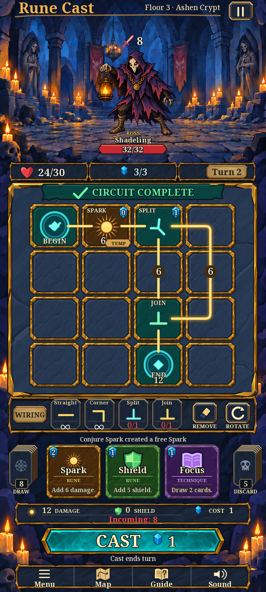

# RC-011 r004 — complete gameplay pilot

October 11, 2026. This revision implements the expanded **asset and editable preview** scope against the [official gameplay image](../../../../output/imagegen/approved/combat-final.png). It replaces the former crypt and supporting-symbol blockouts with painted environment art and complete UI. The official reference remains unchanged. Runtime integration is a later task.

**RC-011 production and assistant technical/art-direction review are complete.** This is a newly assembled, fully painted gameplay pilot with editable text, symbols and connections. It is a reconstruction of the approved style/composition, not a pixel-identical copy of the flattened reference. Assistant review, owner approval and runtime/device acceptance remain distinct.

## Review exports

- [841×1870 reference-size render](../../../../output/art/rc-011/r004/pilot-841x1870.png), [720×1600 design render](../../../../output/art/rc-011/r004/pilot-720x1600.png), [450×1000 desktop render](../../../../output/art/rc-011/r004/pilot-450x1000.png).
- [Native360×640 board](../../../../output/art/rc-011/r004/pilot-360x640.png), [scrolled controls companion](../../../../output/art/rc-011/r004/pilot-360x640-controls.png). These use72px cells and a separate lower viewport, not uniform scaling of the tall artwork.
- [Buttons, rotations, finite stock and endpoints](../../../../output/art/rc-011/r004/pilot-states.png), [grayscale states](../../../../output/art/rc-011/r004/pilot-states-monochrome.png), [137/72px Spark states](../../../../output/art/rc-011/r004/pilot-tile-states.png), [actual-font type specimen](../../../../output/art/rc-011/r004/pilot-type.png).
- [Editable full composition](pilot_review.svg), [native board](pilot_narrow.svg), [native controls](pilot_narrow_controls.svg), [state source](pilot_states.svg), [tile states](pilot_tile_states.svg), [type source](pilot_type.svg), [repeatable composition builder](build_review.py).
- [Independent four-reference visual review](cross-screen-review.md), [hashed visual-review record](../../../../output/art/rc-011/r004/visual-review-validation.json), [artifact checks](../../../../output/art/rc-011/r004/revision-validation.json), [existing asset-plan checks](../../../../output/art/rc-011/r004/asset-plan-validation.json), [four-record manifest reconciliation](../../../../output/art/rc-011/r004/manifest-update.json).

## Current source set

| Asset ID / component | Editable master and review export | Construction |
| --- | --- | --- |
| pilot_shadeling | [1024² ORA](../r002/shadeling.ora), [512² neutral](../r002/exports/shadeling.png), [aligned parts](../r002/exports/shadeling_parts/) | Seven meaningful separated layers; same source and foot anchors as r002; enlarged to match the arena |
| pilot_spark_tile | [512² painted tile ORA](ui/painted_tile.ora), [256² amber export](exports/spark_tile.png), [Spark SVG](ui/spark.svg), [separation mask](ui/painted-frame-mask.svg) | Complementary painted stone face and gold rim, four hidden colour variants, separate live geometry/text/markers |
| pilot_button primary | [1024×256 Cast ORA](ui/cast-button.ora), [512×128 export](exports/button_primary.png), [mask](ui/cast-button-mask.svg) | Separate generated turquoise face and painted gold/dark rim; live labels and shared state overlays |
| pilot_button secondary | [1024×256 navy ORA](ui/navy-panel.ora), [512×128 export](exports/button_secondary.png), [mask](ui/navy-panel-mask.svg) | Separate painted navy face and rough gold rim; reused by HUD, panels and navigation |
| pilot_review crypt | [841×1870 ORA](crypt/crypt.ora), [full clean plate](exports/crypt-background.png), [seven semantic layers](crypt/layers/) | Complete reference-guided environment with no baked character, title, grid or UI |
| pilot_review UI | [Live SVG composition](pilot_review.svg), [construction source](build_review.py), [composition metadata](ui/composition-metadata.json) | Complete original pictograms, ribbon, tiles, detailed hand, piles, bars and navigation; no placeholder symbols or reference screenshot underlay |

- [Crypt ORA](crypt/crypt.ora), [semantic layer exports](crypt/layers/), [repeatable assembly](build_crypt.py), [source and memory record](crypt/metadata.json).
- [Retained generation outputs and exact prompts](raw/), [generation record](raw/generation-record.json). Built-in imagegen produced the crypt and empty tile painting using the current official reference. The unused new actor study is explicitly identified; it is not part of the selected pack.
- [Selected Shadeling ORA](../r002/shadeling.ora), [neutral](../r002/exports/shadeling.png), [aligned parts](../r002/exports/shadeling_parts/), [anchors and generation provenance](../r002/metadata.json).
- [Motion sheet](../../../../output/art/rc-011/r002/pilot-motion-sheet.png), [GIF](../../../../output/art/rc-011/r002/pilot-motion.gif), [48-frame sequence](../../../../output/art/rc-011/r002/pilot-motion-frames/), [timing and reduced-motion counterpart](../../../../output/art/rc-011/r002/pilot-motion-timing.json). These retained parts and motions are reused unchanged.
- [Actual Noto Serif font](../r002/type-geometry/fonts/NotoSerif-Variable.ttf), [SIL OFL licence](../r002/type-geometry/fonts/OFL.NotoSerif.txt), [font provenance](../r002/type-geometry/font-provenance.json), [Spark geometry](../r002/type-geometry/spark.svg).

The crypt has seven distinct semantic paint layers that exactly reconstruct its clean generated plate. It supports repainting, recolouring and replacing regions. The separated regions do not include hidden architecture for arbitrary parallax or relocation; production motion would require paint extension. The large central stone recess is covered by separate board and UI artwork in the full composition.

## Accepted design represented

Circuit paths and wiring glyphs have no flow arrowheads. Only **Remove** and **Rotate** remain as editing actions; Straight, Corner, Split and Join remain wiring selectors. The complete detailed hand includes Draw and Discard piles and counts. The action log, persistent damage/shield/cost/incoming information bar, pointed Cast, turn-ending note, pause and Menu/Map/Guide/Sound navigation are all required visible content.

The full layout uses the official image's illustrative board and values. It is not a seed294 runtime capture or a proof of the undirected evaluator. Infinity supply, BOSS and sample values do not change the accepted finite stock or roster rules. No implied circuit evaluation result, new cycle/repeat-trigger policy or alternative no-cast action is introduced by the painting.

No Git operations are permitted. Runtime scenes, scripts, definitions, project settings, exports and prior raw QA remain untouched. Source folders remain excluded from Godot import. Earlier r001/r002/r003 sources and reviews remain historical evidence.

## Technical refinements

The Shadeling source/export foot anchors remain `(512,896)` / `(256,448)`. In the841×1870 composition, its512² canvas is displayed at384² with top-left `(254,92)`, placing its foot at `(446,428)`. No part is independently resized. The retained motion alpha envelope remains inside32–480 on the512² canvas.

Painted tile bevels require **24px export slice caps** in place of the provisional16px. The512² source and256² export stay unchanged. Cast's longer sculpted ends require **56px left/right and18px top/bottom caps** on the512×128 export; the navy panel requires38px left/right and20px top/bottom. The main87px-high Cast uses35 logical pixel end caps. These replace the early24px left/right button proposal where insufficient. Tall board frames use square stone and a separately sliced rim; stretching the horizontal panel vertically was rejected and corrected. Decorative silhouettes do not define input bounds.

The pilot's full crypt source is841×1870 to preserve the complete approved portrait composition. It supersedes the earlier arena-only crop for this review. RC-015 may derive an appropriate overscanned arena plus surround loading arrangement later; the pilot does not claim that the old1440×720 environment export contract has been device-tested. The seven full-size source layers need not all be retained in memory for a static scene.

All selected raster exports use straight-alpha RGBA with embedded sRGB. ORAs contain genuine distinct paint regions with exact recomposition, not duplicate full-screen layers. Generated brush strokes within each region remain flattened; source brush history was never supplied by the image tool. The newly generated tile, navy panel and Cast are separate clean components, not crops from the approved reference.

Spark retains its128×128 viewBox and exact N(64,0), E(128,64), S(64,128), W(0,64) ports. At rotation zero the compatible pair is W–E; rotations change geometry without directional semantics. Text remains upright. Amber paths have blunt ends; the Rotate action's curved arrow is an intentional action symbol. The tiny infinity symbol is vector geometry because the selected font lacks that glyph in the review renderer.

## Typography and motion direction

Use the acquired **Noto Serif2.015 variable font**, width100. The main title/Cast use weight700; ordinary labels, card descriptions and values use600; the location label uses500. Actual sizes/instances are in the editable SVG and builder. Cream/gold letters carry a dark outline. This is an evidenced practical substitute for the unknown exact reference typeface, not a claim of font identity. The actual SIL Open Font License1.1 file and binary hash are retained. SVG editors without the font may substitute a serif fallback; the PNG specimens use the acquired binary directly through Pillow/FreeType. The missing-glyph defects found in review were replaced with vector symbols. Final Godot font importing/fallback coverage remains RC-012.

The retained six-second,8fps,48-frame PNG sequence and GIF demonstrate idle, attack, recoil and defeat with paired reduced-motion frames and anchor/envelope guides. They are the permitted substitute for MP4 because no video encoder was available. Lean part transforms are sufficient for pilot feasibility. RC-014 must refine hidden anatomy and final poses; RC-017 owns event timing, cancellation and reduced-motion integration.

## Recorded review

### Decoded texture estimate

The selected canonical PNG subset is approximately **7.75MiB static**: the841×1870 crypt plate (about6MiB),512² neutral actor (1MiB),256² tile (0.25MiB) and two512×128 buttons (0.5MiB). Retaining the seven512² actor parts concurrently adds7MiB, for approximately **14.75MiB**. The final validation report lists exact dimensions and byte totals using RGBA8, not compressed file sizes. This subset excludes additional material variants, SVG rasterizations, state overlays, font atlases, intermediate preview surfaces and engine buffers; it is not a complete game-memory measurement.

The seven full-canvas crypt editing layers would consume approximately42MiB on their own if all decoded together. The static pilot uses their single6MiB merged plate. RC-015/RC-016 should choose the necessary crop/layer arrangement instead of treating the complete editing stack as a runtime loading instruction. Device budgets remain unverified.

### Findings

| Criterion | Assistant review and evidence |
| --- | --- |
| Complete reference hierarchy and style | **Pass for the matching-style pilot.** Actual841/720/450exports show the same complete screen hierarchy, painted indigo crypt, lantern character, rough gold/stone frames, amber paths, teal primary and detailed supporting UI. No environment/symbol blockouts remain. New brushwork, icon shapes and Noto letterforms are not pixel-identical to the supplied flattened image |
| Requested visual updates | **Pass.** Blunt undirected paths; only Remove/Rotate editing; detailed hand and draw/discard counts; action log and damage/shield/cost/incoming bar above Cast; pause and four navigation actions |
| Label and glyph readability | **Desktop pass.** Clipped location text, missing infinity/scroll symbols and TEMP/value collisions were corrected in actual exports.137/72cells,24/32/48glyphs and independent narrow viewports inspected. **Physical devices not tested** |
| Source and export integrity | **Pass.** Final artifact/source and existing asset-plan validators both pass: dimensions, RGBA/ICC, distinct ORA layers/exact recomposition, actor anchors/parts, linked SVG resources, font coverage and retained generation hashes.974 original protected files and238 prior revision/reference files remain unchanged; historical RC-010 QA report restored byte-for-byte |
| State/rotation/finite-stock coverage | **Desktop pass after corrections.** Current undirected four-rotation sheet; new137/72tile states; nine button states/combinations; endpoints-only and exhausted finite-stock examples. Labels/values remain separate and visible |
| Frame scaling and alpha | **Desktop pass.** Revised slice caps preserve painted corners; tall board stretching defect removed; transparent component sources and retained actor alpha/motion evidence inspected. Runtime theme scaling remains untested |
| Compatibility with Home/Map/Menu | **Component review pass.** Navy/turquoise hierarchy, gold/cream type and symbols remain compatible; see independent review. Those screens are not newly produced/integrated here |
| Motion feasibility | **Pass for the pilot method.** Required states and reduced counterpart exist, with preserved anchors and tested envelope; final animation production is separate |
| Owner approval | **Not recorded for these reconstructed assets.** Approval belongs to the unchanged supplied reference. No retroactive approval of r001/r002 or exact-copy claim |
| Godot integration and devices | **Not tested / outside RC-011.** No runtime changes, imports, evaluator/control update or device acceptance |

The handoff keeps `source_ready`, `source_only` and `reference_guided` statuses for the four pilot records only. Generated-art rights remain `unresolved` for the later distribution audit; the actual font licence evidence is present. Next numbered task is RC-012, using this complete source/review set and the official reference together.
