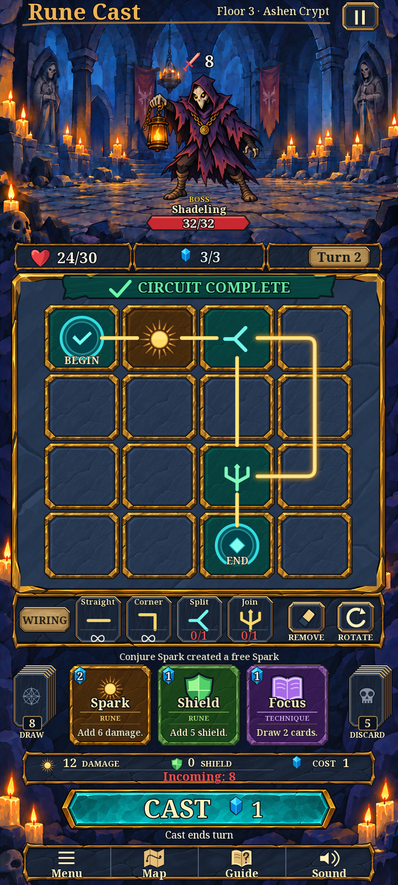

# RC-011 r006 — final-v2 clean-board pilot

October 11, 2026. This revision applies the owner's latest approved [final gameplay reference](../../../../output/imagegen/approved/combat-final-v2-clean-board.png) to the editable pilot. RC-011's purpose is to prove the visual construction, reusable sources, type, scaling, states and motion before production integration. Its scope now includes the complete crypt and supporting UI.

**RC-011 pilot production and assistant visual/source review are complete, including the latest changes.** The supplied reference is owner-approved; that approval remains separate from the review of this assembled pilot. Neither status is a Godot or physical-device result.

## Latest changes

- Inside the board, only **BEGIN** and **END** retain text. Slot names, rune and path values, End total, cost badges and TEMP are removed from the main composition, native board and board specimens.
- Split uses the approved sideways fork; Join uses the upright trident. Shared editable geometry supplies both the board and wiring toolbar, with separate [Split SVG](ui/split.svg) and [Join SVG](ui/join.svg) sources.
- Undirected connection strokes, Remove/Rotate, detailed cards, Draw/Discard, the action log, information bar, Cast and navigation remain. Card costs/descriptions, toolbar labels/stock and external combat values remain readable.
- BOSS remains above Shadeling, as it does in the supplied image. A prior sentence in the current reference documentation incorrectly described it as absent; that sentence is corrected. BOSS/infinity/example values remain illustrative and do not change roster or balance rules.

## Review files

| Deliverable | Current files |
| --- | --- |
| Full composition | [841×1870](../../../../output/art/rc-011/r006/pilot-841x1870.png), [720×1600](../../../../output/art/rc-011/r006/pilot-720x1600.png), [450×1000](../../../../output/art/rc-011/r006/pilot-450x1000.png), [editable SVG](pilot_review.svg) |
| Native narrow layout | [360×640 board](../../../../output/art/rc-011/r006/pilot-360x640.png), [scrolled controls](../../../../output/art/rc-011/r006/pilot-360x640-controls.png), [board SVG](pilot_narrow.svg), [controls SVG](pilot_narrow_controls.svg) |
| States and size checks | [Button/rotation/stock sheet](../../../../output/art/rc-011/r006/pilot-states.png), [monochrome](../../../../output/art/rc-011/r006/pilot-states-monochrome.png), [137/72px tile states](../../../../output/art/rc-011/r006/pilot-tile-states.png), [actual-font specimen](../../../../output/art/rc-011/r006/pilot-type.png) |
| Source and build | [Composition builder](build_review.py), [composition metadata](ui/composition-metadata.json), [validation script](validate_revision.py), [manifest updater](update_manifest.py) |
| Review record | [Independent four-screen review](cross-screen-review.md), [artifact checks](../../../../output/art/rc-011/r006/revision-validation.json), [asset-plan checks](../../../../output/art/rc-011/r006/asset-plan-validation.json), [manifest reconciliation](../../../../output/art/rc-011/r006/manifest-update.json) |

## Editable sources and provenance

No new raster painting or image generation was needed for these changes. The new composition reuses the genuine layered painted sources from r004 and the selected r002 character and font. Earlier sources, previews, raw generations, prompts and approvals remain intact.

| Component | Editable master / retained evidence | Dimensions and method |
| --- | --- | --- |
| Shadeling | [r002 ORA](../r002/shadeling.ora), [neutral](../r002/exports/shadeling.png), [seven parts](../r002/exports/shadeling_parts/), [metadata](../r002/metadata.json) | 1024² source, 512² export; foot `(512,896)` / `(256,448)`; 384² display at `(254,92)` in the main composition |
| Crypt | [r004 ORA](../r004/crypt/crypt.ora), [seven semantic layers](../r004/crypt/layers/), [metadata](../r004/crypt/metadata.json), [current plate](exports/crypt-background.png) | 841×1870; genuine disjoint paint regions with exact recomposition; static plate reused unchanged |
| Tile | [ORA](ui/painted_tile.ora), [Spark SVG](ui/spark.svg), [256² export](exports/spark_tile.png) | 512² master; separate face/rim and colour variants; 24px export slice caps |
| Primary button | [ORA](ui/cast-button.ora), [512×128 export](exports/button_primary.png) | 1024×256 source; separate face/rim; export caps 56 left/right, 18 top/bottom |
| Secondary button | [ORA](ui/navy-panel.ora), [512×128 export](exports/button_secondary.png) | 1024×256 source; separate face/rim; export caps 38 left/right, 20 top/bottom |

The r004 painted source/export copies retain their original bytes, recorded in [reuse dependencies](ui/reuse-dependencies.json). [Original generation record](../r004/raw/generation-record.json) and [prompts/raw outputs](../r004/raw/) preserve the older reference actually used for painting. Final v2 is the new composition target, not retroactively the generation input. Model/version and seed were not exposed by imagegen and remain unknown. Generated brushwork is flattened within separated paint regions; source brush history is unavailable. No cropped approved screenshot is used as production artwork.

The crypt's semantic layers support region editing, not arbitrary parallax without hidden-area repainting. Actor parts retain the demonstrated modest motion envelope; RC-014 must refine final poses and hidden anatomy. See [r004 source/method detail](../r004/delivery.md) for unchanged alpha, separation, anchoring and slice evidence.

## Typography, motion and memory

The pilot uses the actual [Noto Serif 2.015 variable font](../r002/type-geometry/fonts/NotoSerif-Variable.ttf), width 100: weight 700 for title/large actions, 600 for normal labels/values and 500 for the location. [Exact OFL licence](../r002/type-geometry/fonts/OFL.NotoSerif.txt) and [provenance](../r002/type-geometry/font-provenance.json) are retained. This is the practical selected font direction; it is not a claim of identity with the unknown reference font. Editable SVG text remains live; PNG exports use the acquired font binary through Pillow/FreeType.

The unchanged [motion GIF](../../../../output/art/rc-011/r002/pilot-motion.gif), [keyframe sheet](../../../../output/art/rc-011/r002/pilot-motion-sheet.png), [48-frame sequence](../../../../output/art/rc-011/r002/pilot-motion-frames/) and [timing/reduced-motion records](../../../../output/art/rc-011/r002/pilot-motion-timing.json) demonstrate idle, attack anticipation/action, recoil and defeat with anchor/envelope guides. This documented sequence substitutes for MP4. Lean part transforms remain suitable for pilot feasibility; event integration belongs to RC-017.

The unchanged canonical raster subset is approximately **7.75 MiB static**, or **14.75 MiB** with seven actor parts additionally retained, calculated from RGBA dimensions. Seven full-size crypt editing layers alone require about 42 MiB; the static composition uses their single approximately 6 MiB merged plate. These estimates exclude font atlases, SVG/state rasterization, other variants and engine buffers, and are not device measurements.

## Review outcome and handoff

**Begin-symbol correction:** The owner identified an overlap missed in the initial review: the full-size Begin drew its check over an End diamond, while the narrow Begin showed a diamond. The builder now draws a single shared check for Begin and reserves the diamond for End. Main, native and endpoint-state previews were rebuilt and visually rechecked. The earlier source/previews/reports are preserved in [the before-fix archive](../../../../output/art/rc-011/r006/history/begin-overlap-before.zip).

Root and independent reviewers inspected all nine exported PNGs. [The visual review](cross-screen-review.md) records no remaining blocker for the latest changes. Source and asset-plan outcomes are recorded in the linked final reports, with actual output hashes. The four pilot manifest rows retain `source_ready`, `source_only`, `reference_guided` and unresolved generated-art rights. Other asset and reference records remain unchanged.

| Criterion | Recorded result |
| --- | --- |
| Latest clean-board and corrected symbols | **Pass.** Actual main/native boards and all tile specimens show only allowed endpoint text; shared Split/Join geometry matches the approved silhouettes |
| Complete crypt and supporting UI | **Pass for matching-style construction.** Painted environment and reusable components remain, with detailed cards/piles/forecast and no blockout symbols |
| Desktop readability, states, rotations and scaling | **Pass.** Main841/720/450, native360 pair,137/72px states,24/32/48px glyphs, monochrome and actual-font specimen inspected |
| Source integrity and preservation | **Pass.** Source dimensions/alpha/ICC, distinct ORA layers, linked SVG resources, actual font, retained motion/anchors and reuse hashes checked;974original protected files and404prior revision/reference files unchanged; RC-010report restored |
| Typography and motion feasibility | **Pass for pilot method.** Acquired Noto Serif/OFL and retained six-second part-transform/reduced-motion evidence remain usable; production imports and final poses are separate |
| Exact reference identity / owner approval of reconstructed assets | **Not claimed.** Reconstructed painted details, repeated frames and Noto letterforms differ; owner approval applies to the supplied target |
| Godot integration and physical devices | **Not tested.** Runtime and gameplay files are unchanged |

Owner approval of the supplied target does not imply approval of different painted assets. The pilot uses separate original brushwork and Noto letterforms; it is not a pixel-identical copy. Full gameplay integration, the undirected evaluator/control update, final imports and physical-device verification remain separate. No Git operation, runtime edit or gameplay test run is part of this revision. RC-012 is the next numbered production task after this pilot review.
