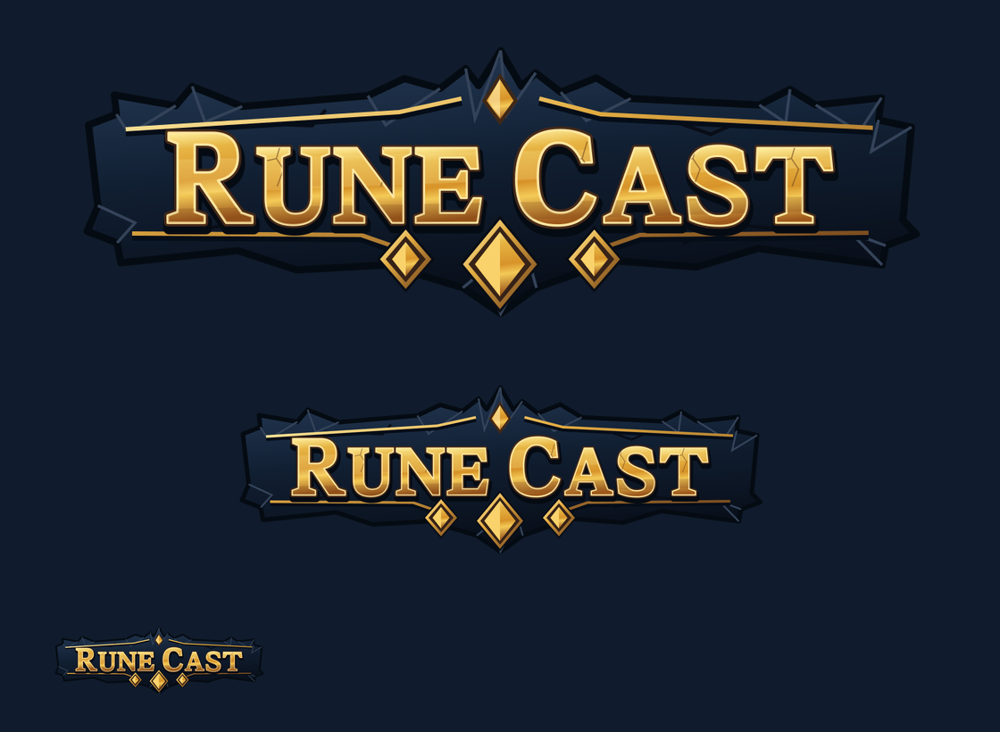

# RC-013 reusable painted UI source delivery

## October 16, 2026 — Unused runtime exports retired

The owner requested unused-resource removal. Retired the unconsumed pile texture alias and eight non-node state SVG exports, their import recipes and caches. Generators now emit only used exports; editable masters and active Map-node vectors remain. [Cleanup record](../../docs/asset-cleanup.md#october-16-2026--unused-resource-cleanup) and [source validation](../../output/qa/resource-cleanup-2026-10-16/ui-source-validation.json).

**October 12 Store clarification:** The owner's later correction renames the Menu entry to Store and separates it from shop rooms. The existing paint, wordmark and sources remain unchanged. [Current corrected Menu renders](../../output/art/rc-013/menu-button-revert/) and the [usage guide](../../docs/ui-theme.md#october-12-correction--store-and-shop-room-separation) supersede the original preview's shop-room-only explanation; historical JSON results remain preserved, with superseded image files retired by the [October13 cleanup](../../docs/asset-cleanup.md#october-13-2026--project-wide-follow-up-cleanup).

October 11–12, 2026. These production masters promote the retained r006 copies of r004 painted UI. The [current Combat contract](../../docs/gameplay-visual-contract.md), approved [Home](../../output/imagegen/approved/home.png), [Map](../../output/imagegen/approved/map.png), [Menu](../../output/imagegen/approved/menu.png), and [r006 composition/state previews](../pilot/revisions/r006/delivery.md) were visually inspected before authoring. Their owner approval applies to those supplied references. These reconstructed materials and the new wordmark remain `reference_guided`.

The exact file-to-file map, selected upstream inputs, SHA-256 values, layer files/masks, dimensions, alpha, colour profiles and slices are in [source-export-map.json](source-export-map.json). [Source integrity validation](../../output/qa/rc-013/source-validation.json) records the original seven masters and 26 exports; the October 16 cleanup below retains 17 used runtime exports. The [final visual review](../../output/qa/rc-013/visual-review.json) records 21 inspected actual Godot captures against six retained reference/pilot images, with hashes and explicit limitations. Runtime presentation and actual Godot results are documented by [the usage guide](../../docs/ui-theme.md).

| Manifest ID | Editable master | Runtime files | Layer selection and construction |
| --- | --- | --- | --- |
| `board_cells` | [board_cells.ora](board_cells.ora) | [board/socket.png](../../assets/ui/board/socket.png), 256² | Independent navy stone face and sculpted gold/dark rim. No glyph, path, text, cost or badge is baked into this socket |
| `ui_frames` | [ui_frames.ora](ui_frames.ora) | [frames/panel.png](../../assets/ui/frames/panel.png), 256² | Same independently editable navy face/rim. Panel/dialog/inspector/navigation/forecast/pile constructions reuse this material. The unused pile alias is retired; piles load panel.png directly |
| `button_frames` | [button_frames.ora](button_frames.ora) | [buttons/primary.png](../../assets/ui/buttons/primary.png), [buttons/secondary.png](../../assets/ui/buttons/secondary.png), 512×128 | Four meaningful layers: turquoise face and pointed Cast rim visible by default; navy secondary face/rim hidden. Export one matching pair at a time |
| `rune_frames` | [rune_frames.ora](rune_frames.ora) | [runes/](../../assets/ui/runes/): damage, shield, technique, mixed, 256² each | Select one amber/green/violet/turquoise face. Use gold rim for damage/mixed, green rim for shield, violet rim for technique. Independent live card cost/name/type/effect/value slots belong to controls |
| `ui_bars` | [ui_bars.ora](ui_bars.ora) | [bars/](../../assets/ui/bars/): track, health, energy, shield, 256×64 | Separate navy/gold track and three painted fill layers. Exports contain no percentages. Fill colour retains the original painted stone luminance; the live value controls its visible extent |
| `ui_state_overlays` | [ui_state_overlays.ora](ui_state_overlays.ora), [editable SVGs](states/) | [states/](../../assets/ui/states/), four Map-node 128² SVGs | ORA contains a distinct isolated layer per vector state in a 4×3 editing atlas. Map runtime uses individual node vectors. The eight non-node cues are drawn by StateLayer; their unused runtime SVG copies are retired. Editable source layers remain |
| `wordmark` | [wordmark.ora](wordmark.ora), [wordmark.svg](wordmark.svg), [six vector layers](wordmark-layers/) | [wordmark.png](../../assets/ui/wordmark.png), 1024×384 | 1280×480 master with six separate geometric parts; custom editable serif lettering, dark extrusion, facets/fractures, indigo crest, gold trim and faceted diamonds. Transparent bounds leave 43/38/39/38 pixels left/top/right/bottom |

All ORAs contain distinct editable content, with exact visible-stack recomposition into `mergedimage.png`. [External semantic layer PNGs](layers/) and [per-layer alpha masks](masks/) support ordinary paint applications; three retained SVG separation masks also identify the face/rim boundaries. The retained brushwork is flattened **within** those complementary paint regions. Neither brush history nor hidden repainting is invented. Hidden colour alternatives are useful selectable faces/rims, not duplicate composites masquerading as editing layers.

## Slicing and technical settings

PNG exports use straight-alpha RGBA8 and embedded sRGB, lossless import, linear filtering, no mipmaps and no repeat. SVG state imports use scale 1. The actual Theme records display border widths independently from texture slice pixels.

| Export | Texture caps, left/top/right/bottom | Typical logical use |
| --- | --- | --- |
| Socket, square frame, detailed card | 24/24/24/24 at 256² | 12-pixel border at nominal 2×; use smaller logical border for 72px cells. Center material and glyphs are independent |
| Pointed turquoise action | 56/18/56/18 at 512×128 | Preserve full-height ends by scaling the end width with control height, approximately 0.4375×height. Stretch only the middle between tips. Do not stretch the whole pointed image |
| Navy secondary | 38/20/38/20 at 512×128 | Fixed painted corners with center stretching; live label padding comes from the Theme |
| Bar track/fill | 16/8/16/8 at 256×64 | Independent track and fill; no baked resource numbers |
| Wordmark | No slices | Uniform aspect-preserving scale only; at least 32px transparent exported padding |

Board geometry must be layered above the socket rim at the exact RC-012 port positions. The paint has no cutout that redefines logical ports. Shared vector overlays leave channels clear; the control owns exact paths and optional powered collars. Decorative children must use `MOUSE_FILTER_IGNORE`. Rectangular input bounds stay at the full control size even where art is transparent.

The retained 17 exports represent **4,194,304 bytes / 4.00 MiB** decoded RGBA8. Unique pixel hashes total **3,932,160 bytes / 3.75 MiB**. Piles share panel.png directly. These estimates exclude font atlases, engine buffers and device measurements.

## Rebuilding and editing

The [builder](../../tools/build_ui_assets.py) reads retained r006 material layers and original RC-013 vector geometry. It writes **only** this production source folder and the bounded UI runtime exports. It does not touch retained pilot files, approved references or main-game settings.

```powershell
& 'C:\Users\nguye\.cache\codex-runtimes\codex-primary-runtime\dependencies\python\python.exe' tools/build_ui_assets.py
& 'C:\Users\nguye\.cache\codex-runtimes\codex-primary-runtime\dependencies\python\python.exe' tools/build_ui_assets.py --validate --report output/qa/rc-013/source-validation.json
```

Dependencies are the bundled Pillow, NumPy and Node `sharp`. `RC_NODE` can override the Node executable path. No network or image-generation call occurs. The builder reproduces the recorded delivery, so save later artist revisions before rebuilding: it intentionally restores the recorded source layers rather than preserving unrecorded manual edits.

For manual paint changes, open the relevant ORA in an OpenRaster-capable editor, edit its named layers, and select the exact pair/variant in the table above. Export the selected composite with transparent alpha at the documented size using Lanczos resampling. Keep the edited ORA and corresponding external semantic layer/mask PNGs together; update the hash/provenance map and rerun the focused validation before adoption. Ordinary labels are not part of this process: they remain live Godot text. For vector states or the wordmark, change the editable SVG geometry and mirror that change in the deterministic builder before rebuilding. Each wordmark SVG layer is independently editable and rasterizable.

## Wordmark provenance and review



The lettering is **original custom serif path geometry**, with larger R/C capitals, independently editable curves and interior counters. It has no font dependency, embedded image or sampled reference pixels. No claim is made that it identifies or duplicates the unknown Home-reference typeface. Ordinary interface text continues to use the RC-012 Noto Serif resources at the specified weights. This decorative wordmark is the explicit exception to live text; launcher/store identity stays with RC-051.

The preview shows proportional 1024×384, 640×240 and 256×96 rendering over indigo. The letterforms remain legible at the header sample; fine fractures and stone detail appropriately simplify at that size. It is a reference-guided geometric identity following the approved gold-serif/indigo-crest direction, not a new tower illustration. The transparent crest, lettering and trim remain separate from Home art and buttons.

## Provenance and readiness boundary

The paint comes from the unchanged r006 canonical copies of r004 outputs. [Original generation record](../pilot/revisions/r004/raw/generation-record.json) and the retained empty-tile/navy-panel/Cast prompts remain authoritative. The tool was built-in `image_gen.imagegen`; model version and seed were not exposed. The painting originally used `combat-final.png`; the clean-board v2 is the current composition target, not a retroactively claimed input. Source pixels are original generated components rather than crops from a supplied screenshot.

No new raster generation was needed for RC-013. New state geometry, wordmark lettering/ornaments, masks, recolour transforms and assembly code were authored for this task. Existing RC-012 icons are reused by the Theme and controls, with no duplicate replacement icon batch.

Retained painted artwork has **unresolved inherited rights provenance**, unchanged from r004/r006. Import success does not resolve that record. Painted manifest packs retain `source_ready` with verified runtime exports/import evidence until rights evidence is resolved. Independently authored vectors, wordmark and Theme can carry their separately evidenced readiness. No approval of the reconstructed assets, main-game integration or physical-device verification is inferred.

The [focused source report](../../output/qa/rc-013/source-validation.json) passes 253 checks: seven real multi-layer ORAs and exact visible recomposition, external alpha masks, all PNG dimensions/ICC/straight-alpha coverage, nonempty slice centers, runtime exports reconstructed from the exact named ORA layers, vector independence, retained input hashes, clear board-edge channels and safe wordmark padding. Actual Godot layout and import checks are separate evidence. RC-016A remains the prerequisite for gameplay/control migration; RC-016/RC-042 own binding these presentation assets to the game.

